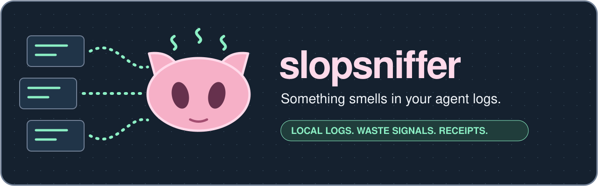
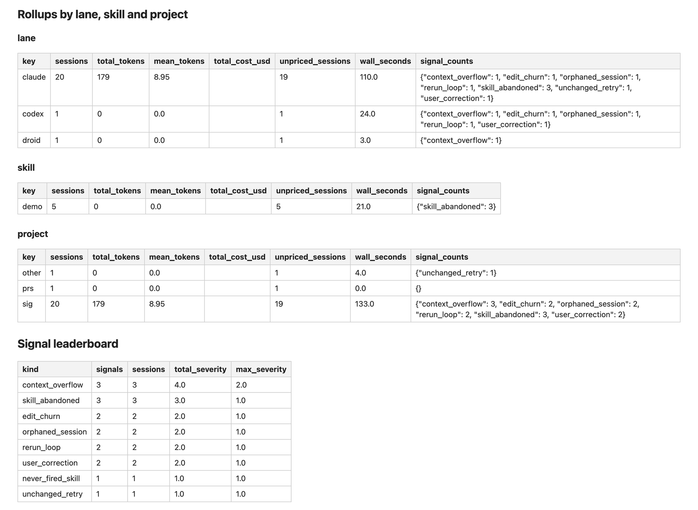

<p align="center">
  
</p>

# slopsniffer 👃🐽

**Something smells in your agent logs.**

[](.github/workflows/ci.yml)
[](pyproject.toml)
[](LICENSE)

Your agent ran the same command again. And again. Then edited the same file into soup,
forgot the plan, and declared victory. 🤖🍲🏆

Release the pig. 🐽🔍 slopsniffer reads the transcripts already on your disk, digests them
into a local DuckDB database, and follows the stink from wasted effort to actual outcomes.
Receipts included. 💩🧾

## What it sniffs 🐽🔍

- 🔁 **Rerun loops and unchanged retries.** Repeated commands with identical results,
  or an unchanged retry that fails again.
- 🌀 **Edit churn.** Repeated failed verification between edits to one file; ordinary
  progressive edits are excluded.
- 🗣️ **User corrections.** “That's wrong” becomes evidence instead of disappearing into the void.
- 👻 **Abandoned skills and orphaned sessions.** Errors near a skill invocation,
  old dangling tool calls and stale Pickle runs. Unused inventory is informational.
- 🧠💥 **Context overflow.** Active compactions mark context overhead; they are informational, not proof of waste.
- 📉 **Outcomes.** Link sessions to branches, commits, PRs and ticket mentions; fetch PR state,
  reviews, CI at head and revert status through `gh`.
- 🧪 **Optional LLM grading and proposals.** Rank the worst sessions, grade transcript chunks,
  then draft instruction changes for repeated failures. Drafts land beside the database for
  your review; your actual skills and rules stay yours.

Signals are deterministic SQL with event IDs pointing to the evidence. Rollups show tokens,
cost, wall time and signals by harness, skill, project, day and week. Known dollars are
retained in explicitly partial totals; unknown models and their token volumes are listed.
[Pricing rules and overrides](docs/pricing.md) explain the estimates. The snout does not invent your bill. 🐽💸

## Quickstart 🚀🐽

You need Python **3.14+** and [uv](https://docs.astral.sh/uv/).
Install directly from git:

```bash
uv tool install git+https://github.com/gregorydickson/slopsniffer.git
slopsniffer --version
slopsniffer --help
slopsniffer run
slopsniffer report --html report.html
```

Open `report.html` in your browser. It's a self-contained page that works offline. 📊👃

`run` ingests configured sources, computes signals, then attempts GitHub outcomes. Install and
authenticate `gh` for that last step. Without usable `gh`, local analysis still runs, outcomes
are skipped with a diagnostic, and `run` exits with code `3` (partial failure).
For local analysis without GitHub calls:

```bash
slopsniffer ingest
slopsniffer signals
slopsniffer report --html report.html
```

Refresh manually by running again. Unchanged files are skipped; growing files resume at their
committed offset. Changed or truncated prefixes are re-ingested. Even malformed lines leave
event records. A first full ingest can take hours on a large history. Progress goes to
stderr, including with `--json`. Crush keeps durable row exports
for [rehydration](docs/formats/crush.md). The garbage deserves chain of custody. 💩🔬

From a source checkout, use `uv run`:

```bash
uv sync --locked
uv run slopsniffer --version
uv run slopsniffer --help
uv run slopsniffer status
uv run slopsniffer query "SELECT kind, count(*) AS n FROM signals GROUP BY kind ORDER BY n DESC"
```

## Supported harnesses 🤖🥒

These are the default sources; override them under `[ingest.sources]` in your config.

| Lane | Default location | What gets sniffed |
|:---|:---|:---|
| `claude` | `~/.claude/projects` | Claude Code `*.jsonl` transcripts, including subagents |
| `codex` | `~/.codex/sessions` | Codex `rollout-*.jsonl` transcripts |
| `crush` | `~/.local/share/crush/projects.json` | Project SQLite databases, read through consistent backups; [row rehydration](docs/formats/crush.md) |
| `droid` | `~/.factory/sessions` | Droid `*.jsonl` transcripts and `*.settings.json` usage sidecars |
| `pickle` | `~/.local/share/pickle-rick/sessions`, `~/.claude/pickle-rick/sessions` | Pickle run directories containing `state.json`; logs in the run and immediate ticket subdirectories |
| `skills` | `~/.claude/skills`, `~/.agents/skills`, `~/.codex/skills`, `~/.claude/plugins` | Installed `SKILL.md` files, plus `.claude/skills`, `.agents/skills` and `.codex/skills` in repositories discovered from sessions |

Crush projects are found through `~/.local/share/crush/projects.json`, using each
project's configured data directory or `.crush/crush.db`. When the index exists,
`~/.crush/crush.db` is checked too. The snout opens each live database read-only
and uses SQLite's backup API for a consistent temporary snapshot, including
committed WAL data. slopsniffer never writes to Crush. 🐽🔒

Pickle logs supply run, iteration and session links. Skills are an inventory, so they don't
have the transcript lanes' file-status breakdown. No magical support for every harness ever
conceived in a weekend hackathon. 🐽

```bash
slopsniffer ingest --harness claude,codex --since 2026-01-01 --workers 2
slopsniffer signals --kind rerun_loop --lane claude
```

## What uses an LLM 🧪🧠

Ingest, pricing, signals, outcomes and reports are deterministic and free to run:
no model calls or model charges. Outcomes can query GitHub through `gh`.
Only `grade`, `run --grade` and proposals (`propose`) call a model, through your
installed `claude -p` or `codex exec` CLI, on your own account. `auto` tries Codex
first, then Claude. The pig borrows your nose budget. 🐽💸

**Grading can get expensive fast.** A three-session smoke on a Haiku-class model
used about 17 million input tokens, approximately $15 at list price. Long
transcripts and multiple rubrics add up; actual charges depend on your provider,
caching and account terms. Start with `--worst 1` and inspect usage before widening
the trough:

```bash
slopsniffer grade --worst 1 --max-calls 40
slopsniffer propose
```

`run --grade --worst N` adds grading after outcomes; `--grade` and `--worst` must go together.
`grade --regrade` revisits already graded sessions. A changed rubric makes its older grades
stale. The grading menu: 🍽️🤖

| Rubric | Labels | Session verdict |
|:---|:---|:---|
| efficiency | `highly_efficient`, `mostly_efficient`, `mostly_inefficient`, `highly_inefficient` | mean chunk score |
| code-quality | `approve`, `block`, `insufficient_evidence` | worst chunk |
| procedure-compliance | `fully_compliant`, `mostly_compliant`, `noncompliant` | worst chunk |
| verbosity | `proportionate`, `verbose`, `terse` | mean chunk score |

Proposals need failures across multiple sessions, or one procedure-compliance failure that
breaches a protective rule. Passing clusters become draft `SKILL.md`, `change.diff` and
`evidence.json` files under `<data dir>/proposals/<skill>/`. Rejected clusters keep their
reasons. The pig has an evidence bar. 🐽⚖️

## Commands 🧰👃

| Command | Purpose |
|:---|:---|
| `slopsniffer run [--grade --worst N]` | ingest, signals, outcomes, optionally grade |
| `slopsniffer ingest [--harness claude,codex,crush,droid,pickle,skills] [--since DATE] [--workers N]` | ingest new or changed source files |
| `slopsniffer signals [--kind K ...] [--project P] [--lane L] [--since DATE]` | recompute signals and list filtered results with rollups |
| `slopsniffer outcomes [--refresh]` | link sessions and refresh GitHub PR outcomes |
| `slopsniffer grade --worst N [--backend auto\|codex\|claude] [--max-calls M] [--regrade]` | grade the worst sessions |
| `slopsniffer propose [--backend auto\|codex\|claude]` | draft instruction edits from eligible failure clusters |
| `slopsniffer report [--html PATH]` | print the JSON report or write HTML |
| `slopsniffer query "SQL"` | read-only SQL with DuckDB external access disabled |
| `slopsniffer rehydrate EVENT_ID` | print an event's original source bytes |
| `slopsniffer status` | show ingest state and database summary |

Every subcommand accepts `--help`, `--json` and `--config PATH`. The last two also work before
the subcommand. `--json` emits one document on stdout, with diagnostics on stderr; schemas
live in [`schemas/cli/`](schemas/cli/). `rehydrate --json` returns base64 instead of raw bytes.
`report --html PATH --json` both writes HTML and emits JSON. `--version` is a top-level flag.
Dates use `YYYY-MM-DD`.

Exit codes: `0` success, `2` usage/config error, `3` partial failure, `4` database locked.

## Config and `.env` ⚙️🐽

Config precedence: `--config PATH`, then `$SLOPSNIFFER_CONFIG`, then
`~/.config/slopsniffer/config.toml`. The chosen file merges over
[`default_config.toml`](src/slopsniffer/default_config.toml). Only known keys with matching
types are accepted; `pricing.models` also accepts new model entries of the existing shape.
Explicitly named config files must exist.

Example config:

```toml
[ingest]
memory_limit = "1GB"
workers = 2

[signals]
rerun_min = 4

[outcomes]
ticket_pattern = 'ACME-\d+'
```

Ticket linking is off by default. Patterns use RE2 syntax, match case-insensitively at word
boundaries in branches and user/assistant text, and store uppercase matches. Injected context
is excluded. No tracker API is called. 🎟️🔍

Copy [`.env.example`](.env.example) to `.env` at the source checkout root, or point
`SLOPSNIFFER_ENV_FILE` to an existing file:

```dotenv
SLOPSNIFFER_TICKET_PATTERN='ACME-\d+'
SLOPSNIFFER_CONFIG=~/.config/slopsniffer/config.toml
SLOPSNIFFER_HOME=~/.local/share/slopsniffer
```

`SLOPSNIFFER_TICKET_PATTERN` overrides `outcomes.ticket_pattern`; an empty value disables
linking. Real environment variables win over `.env`. Values are literal (no shell expansion),
with one pair of matching quotes removed. The file is never exported to child processes.
A tool install does not discover a source checkout's `.env`; use shell variables or
`SLOPSNIFFER_ENV_FILE` there.

Data goes in `$SLOPSNIFFER_HOME`, default `~/.local/share/slopsniffer`: `telemetry.duckdb`,
`telemetry.lock`, `tmp/` for DuckDB spills, and `proposals/` for drafts. A data directory
inside the source repository is refused. DuckDB's default buffer cap is `512MB`; parser
processes and allocator overhead add to total memory use. 🦆💾

## The report 📉🔍

Rollups, signal leaderboard, top findings, current grades, proposal diffs and rejected
clusters, all in one offline page. Findings include the session title, branch, project,
harness, date, duration, known cost, a plain-language explanation and a resume command.
Evidence and rehydrate commands are collapsed by default. Rankings disclose their basis;
normal compaction and unused inventory do not compete with actionable findings.
Claude subagent findings identify the parent conversation and include a transcript command.
Home paths display as `~/...`; stored data is unchanged.
[The precision audit](docs/signal-precision.md) explains the methodology, aggregate
results and limitations. Historical screenshot from synthetic test fixtures:

<p align="center">
  
</p>

## Privacy

Ingestion, analysis and storage are local. The program reads configured transcript roots,
Droid usage sidecars, Pickle run state/logs, installed skill files, and repository skill files
discovered from sessions. Transcripts may contain messages, commands, paths, tool output and
injected instructions or context. Parsed records and source locations are stored in the local
database; source lines have event records even when parsing fails. `rehydrate` reads original
bytes from the source file and requires that file and its ingested prefix to remain intact.
Reports read stored proposal diffs. Treat the database, reports and proposal evidence as
sensitive as the source logs.

`ingest`, `signals`, `report`, `query`, `status` and `rehydrate` make no network calls.
`outcomes`, also invoked by `run`, reads local git origin metadata and uses authenticated
`gh` to send repository names, PR identifiers and outcome queries to GitHub. It does not
upload transcripts. Ticket matching is local.

`grade`, `run --grade --worst N` and `propose` invoke `codex exec` or `claude -p`. Rendered
transcript chunks and grading rubrics are sent through that CLI to its model provider;
proposals send the instruction file and attributed failure evidence. These calls use your
CLI credentials and provider settings. Codex uses `--ephemeral`; Claude uses
`--no-session-persistence` to avoid creating new local session transcripts for ingestion.
Those flags do not promise provider-side deletion or zero retention. No separate telemetry
service is used by slopsniffer.

## Development 🧪🔧💩

From a clone:

```bash
uv sync --locked
uv run ruff check
uv run ruff format --check
uv run mypy --strict src tests
uv run pytest
uv run mutmut run --max-children 8
```

Tests use synthetic fixtures and temporary homes/data directories. Browser layout checks need
Chrome or Chromium. Mutmut scope lives in [`setup.cfg`](setup.cfg); documented equivalent and
out-of-scope mutants live in the [exemption ledger](docs/mutation-exemptions.md). Keep that
ledger honest when changing behavior. A green test suite is good; a test that notices the bug
is better. 🐽🧬

## Credits and license 🫶

MIT; see [LICENSE](LICENSE). Grading rubrics and skill-improvement guidelines are vendored
from [warpdotdev/common-skills](https://github.com/warpdotdev/common-skills)' skill-doctor,
under its MIT license, Copyright (c) 2026 Denver Technologies, Inc. The pinned source and file
mapping are in [SOURCE.md](src/slopsniffer/grading/rubrics/SOURCE.md), with the upstream license
beside it.
